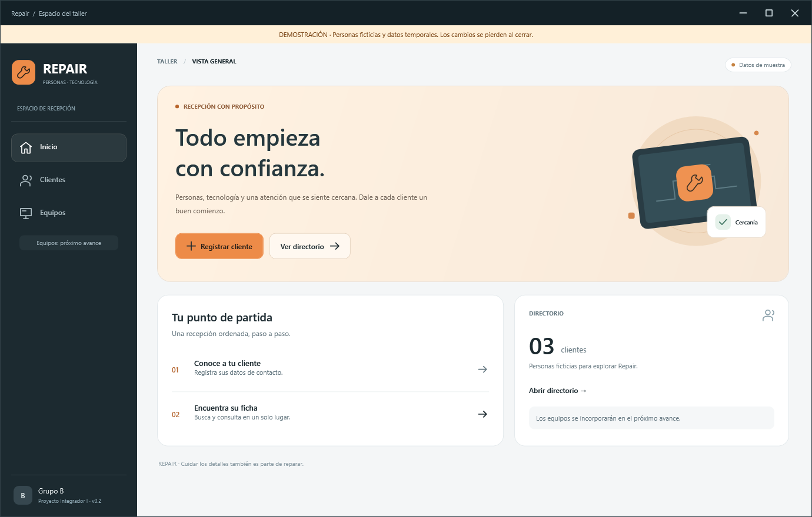

# Repair · clientes y equipos en WPF

**C# · WPF/XAML · .NET Framework 4.8 · Visual Studio 2022 · SQL Server previsto**

Repair es el proyecto académico del Grupo B para organizar la recepción de un taller de reparación de equipos de cómputo. Esta entrega reúne la base WPF de clientes preparada con Josias y la integración de equipos desarrollada por Oliver. El diseño utiliza grafito, acero y naranja.

**Estado revisado el 15/10/2026:** integración de Oliver sobre la base WPF v0.2, commit [`0581cc0`](https://github.com/OliverSoftwaree/Repair.Wpf/commit/0581cc0b49e48d33a36d76417e59c0970e51816d). La solución compila y las comprobaciones de lógica pasan. **SQL Server y el recorrido completo de equipos todavía requieren verificación.** No se presenta la demostración como persistencia real.

## Empezar en Visual Studio

1. Clona este repositorio o descarga y extrae su ZIP completo.
2. Abre **Repair.Wpf.sln** con Visual Studio 2022. Necesitas la carga de trabajo de escritorio de .NET y el Developer Pack de **.NET Framework 4.8**.
3. Establece **Repair.Wpf** como proyecto de inicio y selecciona **Debug / Any CPU**.
4. Compila y pulsa **F5**. El proyecto propone el argumento **`--demo`** en Debug: comprueba la banda de demostración y la etiqueta «Datos de muestra».
5. Entra en **Clientes** para registrar, buscar y consultar; entra en **Equipos** para explorar el trabajo de Oliver.

No se requieren paquetes NuGet ni bibliotecas visuales externas. Las ventanas se describen en `.xaml` y su comportamiento en `.xaml.cs`; esta implementación utiliza WPF, aunque existan antecedentes en WinForms y web MVC.

Si tu configuración de Visual Studio sustituye los argumentos de depuración, escribe `--demo` en **Propiedades del proyecto → Depurar → Argumentos de la línea de comandos**. Otra selección explícita es `Modo=Demostracion` en `Repair.Wpf/App.config`, recompilando después. El valor admitido es **`Demostracion`**, sin tilde; `Demo` no activa ese modo en la implementación actual.

Para probar un ejecutable Release ya compilado, desde la carpeta de la solución:

```powershell
& '.\Repair.Wpf\bin\Release\Repair.Wpf.exe' --demo
```

## Lo que incorpora el avance

| Área | Funcionalidad programada |
| --- | --- |
| Inicio y navegación | Panel principal, acceso a clientes y página integrada de equipos. |
| Clientes | Alta, listado, búsqueda por nombre/teléfono/correo/ID numérico, validaciones y ficha de solo lectura. |
| Equipos en la página principal | Selector de cliente, marca, modelo, serie, accesorios y condición; registro, listado, selección para cargar los datos, actualización y eliminación. |
| Equipos en ventana separada | Acceso «Abrir en ventana», con selector de cliente, registro y listado. Esta vista no ofrece los mismos botones de edición que el control integrado. |
| Lógica de equipos | Normalización, campos obligatorios, límites y comprobación previa de duplicados por cliente + marca + modelo + serie. |
| Acceso a datos | Interfaces de repositorio e implementaciones para SQL Server y demostración en memoria. |
| Diseño | Tema compartido, iconos vectoriales, navegación compacta y adaptación del directorio de clientes; transiciones de páginas/paneles. |

La selección de un equipo en el control integrado rellena el formulario y habilita las acciones de edición. Existe una ruta de refresco del selector de equipos cuando se registra un cliente. Estas funciones se identificaron en el código; no se ha aprobado todavía todo el recorrido de uso con SQL real.

No están implementados órdenes de reparación, diagnóstico, seguimiento, entrega, reportes, autenticación/roles ni respaldos completos. Facturación, cobros e inventario de repuestos permanecen fuera del alcance. La edición y eliminación de clientes tampoco forman parte de este avance.

## Demostración y SQL son modos diferentes

### Demostración

- Se activa con `--demo` o con `Modo=Demostracion`.
- Comienza con tres clientes ficticios y equipos de muestra.
- Los cambios son temporales: se pierden al cerrar y no demuestran guardados en SQL Server.
- Actualmente la página integrada y la ventana separada crean repositorios de equipos distintos. En demostración, los registros de una vista no tienen por qué aparecer en la otra; al reabrir la ventana separada se crea otra colección de muestra.

Para explorar equipos, trabaja primero en la página integrada: selecciona un cliente, escribe marca y modelo, añade una condición de al menos cinco caracteres y pulsa Guardar. Selecciona una fila para revisar sus datos y probar Actualizar o Eliminar **sobre la demostración**. Anota cualquier resultado inesperado; estas acciones no están cubiertas completamente por las comprobaciones actuales.

### SQL Server

Con `Modo=Sql`, ejecutando sin `--demo`, la aplicación selecciona repositorios SQL y la autenticación de Windows de la configuración. No cambia automáticamente a memoria si una conexión falla.

**La instalación de la base completa desde cero no está resuelta en este repositorio:** solo está incluido [`sql/01-Clientes.sql`](sql/01-Clientes.sql). No está incluido `sql/02-Equipos.sql`, necesario para reproducir la tabla y la relación de equipos. El primer script crea únicamente la base del proyecto y clientes; no instala equipos.

Antes de probar SQL:

1. Obtener y revisar el script de equipos que corresponda al avance, incluida la clave foránea hacia `dbo.Clientes(Id)` y sin borrado en cascada.
2. Confirmar una instancia y una base de desarrollo exclusivas de Repair. El nombre de ejemplo es `RepairAcademico`; no utilizar bases de otros trabajos.
3. Ajustar `Data Source` en [`Repair.Wpf/App.config`](Repair.Wpf/App.config) a la instancia real. Mantener la autenticación Windows cuando corresponda y no publicar contraseñas ni archivos de bases personales.
4. Quitar `--demo` de la depuración y conservar `Modo=Sql`.
5. Revisar los pendientes técnicos indicados abajo antes de considerar aprobado el alta SQL. Después comprobar registro, consulta, actualización, eliminación y permanencia al reiniciar.

Un mensaje de éxito con «Datos de muestra» visible no prueba SQL. Una captura de columnas tampoco demuestra por sí sola todas las restricciones o la persistencia de las operaciones.

## Organización del repositorio

```text
Repair.Wpf.sln
Repair.Core/
  Modelos/          Cliente y Equipo
  Logica/           Servicios y validaciones
  Datos/            Contratos y repositorios SQL
  Integracion/      Consultas compartidas y contrato de datos previo
Repair.Wpf/
  App.xaml.cs       Inicio y selección de modo/repositorios
  MainWindow.*      Navegación, clientes e integración de equipos
  EquiposWindow.*   Ventana separada de registro/listado
  Presentacion/     EquiposControl, filas y reglas de adaptación
  Demostracion/     Repositorios temporales de clientes y equipos
  Integracion/      IModuloEquipos y ModuloEquipos
  Temas/            Estilos e iconos compartidos
Repair.Comprobaciones/
  Program.cs        Comprobaciones de lógica/presentación
  PruebasVisuales.cs Controles WPF y generación de vistas
sql/                Script disponible de clientes; equipos pendiente
docs/               Documentación y evidencias históricas de la base
```

El recorrido principal es **interfaz → servicio → repositorio → SQL o memoria**, según el modo elegido al iniciar. `Repair.Core` mantiene las reglas separadas de la interfaz. No se han movido carpetas ni reescrito los módulos para actualizar este README.

## Validaciones de equipos presentes en el servicio

| Campo | Regla programada |
| --- | --- |
| ClienteId | Debe ser mayor que cero; la existencia real y la relación en SQL requieren verificación. |
| Marca | Obligatoria, 1–60 caracteres, sin caracteres de control. |
| Modelo | Obligatorio, 1–100, sin caracteres de control. |
| Serie | Opcional, hasta 100, sin caracteres de control. |
| Accesorios | Opcionales, hasta 300. |
| Condición | Obligatoria, 5–500. |

La comprobación de duplicados del servicio no equivale a una restricción de unicidad en SQL ni acredita protección frente a operaciones concurrentes. No se da por verificada una clave foránea cuya definición no está incluida en el repositorio.

## Comprobaciones ejecutadas

Sobre el commit revisado, el 15/10/2026:

| Comprobación | Resultado y límite |
| --- | --- |
| Compilación Release | **0 errores, 0 advertencias**, usando MSBuild de VS2022. |
| Lógica/presentación | **33 correctas, 0 fallidas**: 28 heredadas de la base y cinco de equipos. |
| Casos de equipos | Alta válida/delegación y rechazo de ClienteId inválido, marca vacía, modelo vacío y condición corta. Usan un repositorio de prueba; no verifican SQL, edición/eliminación reales ni todos los límites. |
| Controles WPF heredados | **15 correctas**, 12 vistas renderizadas. Cubren principalmente el recorrido de clientes y estados de la base; no certifican el módulo completo de equipos. Un texto de prueba aún menciona «módulo pendiente» aunque ya exista la integración. |
| Sondeo SQL de solo lectura | **No comprobado**: SqlClient no pudo inicializar sus contadores en el entorno restringido AppContainer. No se creó ni modificó ninguna base. |
| Uso nativo y animaciones | Foco, teclado, ratón, escalas/monitores y fluidez real pendientes de revisión manual. Los PNG usan renderizado por software y animaciones desactivadas. |

Para repetir las comprobaciones después de compilar Release, desde la carpeta de la solución:

```powershell
# Lógica/presentación
& '.\Repair.Comprobaciones\bin\Release\Repair.Comprobaciones.exe'

# Controles y vistas estáticas; no equivale a uso nativo de la aplicación
& '.\Repair.Comprobaciones\bin\Release\Repair.Comprobaciones.exe' --visual '.\vistas-de-prueba'

# Solo lectura; no instala ni comprueba la persistencia de RepairAcademico
& '.\Repair.Comprobaciones\bin\Release\Repair.Comprobaciones.exe' --sql-probe
```

El código de salida es 0 si las comprobaciones pasan y 1 si fallan; el sondeo devuelve 1 cuando no consigue verificar ninguna conexión. La compilación realizada en esta sesión necesitó rutas explícitas al SDK y a las referencias de .NET Framework por restricciones de acceso al Registro, sin modificar los proyectos ni el sistema.

## Pendientes detectados por lectura de código

Estos puntos se dejan registrados para un próximo trabajo autorizado; **no se corrigieron al actualizar la documentación**:

- Falta el script de equipos para instalar la base completa desde cero.
- `EquipoServicio.RegistrarAsync` espera una búsqueda con `.GetAwaiter().GetResult()`. Con operaciones SQL que continúen en el mismo contexto, puede bloquear la interfaz WPF; las pruebas con tareas ya completadas en memoria no descartan ese problema.
- El INSERT de `EquipoSqlRepositorio.AgregarAsync` contiene `\nOUTPUT` dentro de una cadena textual `@"..."`: ese `\n` es literal y debe revisarse antes de aprobar el alta SQL.
- En la demostración se genera el ID con `filas.Count + 1`; eliminar y registrar después puede repetir un ID existente. Las colecciones separadas de las dos vistas tampoco ofrecen una sesión de equipos compartida.
- Falta verificar el recorrido completo de guardar/actualizar/eliminar, los errores y la relación con un cliente real. Los repositorios de prueba actuales no acreditan esos resultados.

## Documentación y colaboración

La documentación y las imágenes conservadas en `docs/` describen principalmente la **base v0.2** y su reparto original. Se mantienen como historial; sus menciones a «equipos pendiente» o a pruebas anteriores no sustituyen el estado actual descrito aquí:

- [Diseño y arquitectura de la base](docs/DISENO-Y-ARQUITECTURA.md).
- [Pruebas históricas de la base](docs/PRUEBAS.md).
- [Guía original de trabajo para Oliver](docs/GUIA-OLIVER.md).
- [Registro del cambio a WPF](docs/CAMBIO-A-WPF.md).



Esta imagen es un render de la base anterior; no es una evidencia nueva del CRUD de equipos ni de SQL.

Para colaborar, partir del estado actualizado de `master`, mantener las tareas en ramas propias y revisar el cambio antes de integrarlo. Si hay modificaciones locales, conservarlas antes de sincronizar. No subir `.vs`, `bin`, `obj`, bases, copias de seguridad ni credenciales. Las actualizaciones del código deben permanecer en el chat local de desarrollo; el chat «Proyecto integrador I» se dedica a explicación y documentación académica.

Esta revisión actualiza únicamente el README. No añade funcionalidades, no acredita un porcentaje de avance académico y no convierte las 36 comprobaciones del antiguo prototipo web en evidencia de esta implementación.
