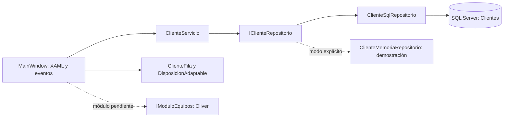

# Repair v0.2 — diseño y estructura

## Intención visual

La interfaz representa un taller que cuida tanto la tecnología como la atención a las personas. La llave y el monitor son ilustraciones vectoriales propias del código; no se descargaron iconos, fotografías ni tipografías. La frase de inicio es “Todo empieza con confianza”.

| Elemento | Decisión |
| --- | --- |
| Grafito `#1C2A30` | Navegación y estructura del espacio de trabajo. |
| Acero `#697B84` | Información secundaria y contactos. |
| Naranja `#ED8B48` | Acciones principales y marca. |
| Fondo `#F4F6F7` | Área de trabajo clara, con tarjetas blancas. |
| Tipografía | Segoe UI del sistema, jerarquía por tamaño y peso. |
| Formas | Esquinas redondeadas, bordes ligeros, espaciado consistente. |
| Estados | Carga discreta, vacío explícito, error legible y confirmación temporal. |

No hay cifras inventadas de reparaciones, ingresos o equipos. El contador muestra el número de clientes de la consulta completa; ante un error se muestra “—”. El modo de muestra siempre lleva una banda visible y utiliza personas ficticias.

## Adaptación al ancho y a la altura

Los tamaños se expresan en unidades lógicas de WPF, no en píxeles físicos del monitor. La ventana solicita escala por monitor mediante su manifiesto; la validación en monitores reales y distintas escalas sigue pendiente.

- Desde **1280** de ancho: ilustración de inicio, menú completo y tabla.
- Desde **1180**: directorio en tabla; por debajo cambia a tarjetas con los mismos clientes y acceso a ficha.
- Por debajo de **1100**: menú de iconos con ayudas al pasar el puntero y márgenes compactos.
- Por debajo de **1000**: los bloques inferiores del inicio se apilan.
- Mínimo de ventana: **760 × 600**. El inicio y el editor tienen desplazamiento vertical; Guardar/Cancelar permanecen en una franja propia.
- El panel lateral ocupa hasta **480** de ancho y respeta el espacio disponible.

Las reglas están en `Presentacion/DisposicionAdaptable.cs`. Los contenedores Grid, las proporciones y el desplazamiento completan la distribución. “Adaptable” no significa que esta aplicación esté diseñada para teléfonos: sigue siendo escritorio Windows.

## Movimiento

Se animan opacidad y transformaciones de presentación, evitando recalcular el diseño en cada fotograma:

| Interacción | Duración y comportamiento |
| --- | --- |
| Cambio de sección | Opacidad de 0 a 1 en 230 ms; subida de 12 a 0 unidades en 260 ms. |
| Apertura de panel | Desvanecimiento de fondo en 200 ms; panel en 240–270 ms, con desplazamiento de 40 a 0 unidades. |
| Cierre de panel | Desvanecimiento y desplazamiento suave en 160 ms. |
| Confirmación | Aparición en 180 ms, visible hasta 5 segundos; se retira al abrir un panel. |

Se utiliza `CubicEase` de salida en las entradas y se consulta `SystemParameters.ClientAreaAnimation`. Al desactivar las animaciones de Windows, los estados aparecen directamente. No se cambian ajustes del sistema. **La implementación existe, pero todavía no se midieron fluidez, FPS ni respuesta real del dispositivo.**

## Capas y flujo

`Repair.Core` no referencia WPF ni Windows Forms. Contiene `Cliente`, `ClienteServicio`, `ValidacionException`, `IClienteRepositorio`, `ClienteSqlRepositorio`, `AccesoDatosException`, `IConsultaClientes` y la propuesta `EquipoContrato`.

`Repair.Wpf` contiene la interfaz. La lógica de interacción se mantiene en el archivo asociado al XAML para que esta primera etapa sea fácil de seguir. No se añadió un contenedor de dependencias ni una arquitectura completa de MVVM. El constructor de diseño construye la vista sin abrir conexiones.

`Repair.Comprobaciones` referencia ambos proyectos. Sus repositorios de prueba y fallos simulados nunca se seleccionan por un error SQL de producción.

## Reglas y esquema conservados

| Dato de `dbo.Clientes` | Tipo SQL | Regla de aplicación |
| --- | --- | --- |
| `Id` | `int IDENTITY`, clave primaria | Generado en SQL. |
| `Nombre` | `nvarchar(100) NOT NULL` | 2–100 caracteres, alguna letra, sin caracteres de control. |
| `Telefono` | `nvarchar(25) NOT NULL` | 7–15 dígitos ASCII, con signos de formato permitidos. |
| `Correo` | `nvarchar(150) NULL` | Opcional; comprobación de formato, sin verificar la existencia del buzón. |
| `Notas` | `nvarchar(300) NULL` | Opcionales. |
| `CreadoUtc` | `datetime2(0) NOT NULL` | Predeterminado `SYSUTCDATETIME()`, mostrado en hora local. |

Se recortan espacios exteriores. Los errores se devuelven por campo antes de acceder a datos. SQL aplica comprobaciones básicas de longitud; la aplicación contiene el formato completo. Teléfono y correo no tienen unicidad porque esa regla no fue acordada.

La búsqueda admite hasta 100 caracteres: ID numérico exacto o coincidencia parcial en nombre, teléfono o correo. El código mostrado `CL-0004` corresponde al ID numérico `4`; la búsqueda por código se escribe con el número. Los valores se envían como parámetros, y se escapan los comodines de `LIKE`. La intercalación de SQL determina la comparación de tildes y mayúsculas; el repositorio temporal no demuestra ese comportamiento real.

El esquema únicamente incluye clientes. La relación prevista **Cliente 1 → N Equipos** sigue sin implementarse. Oliver debe entregar su tabla con clave foránea y las reglas del módulo. No hay migración ni acceso a bases de otros proyectos.
